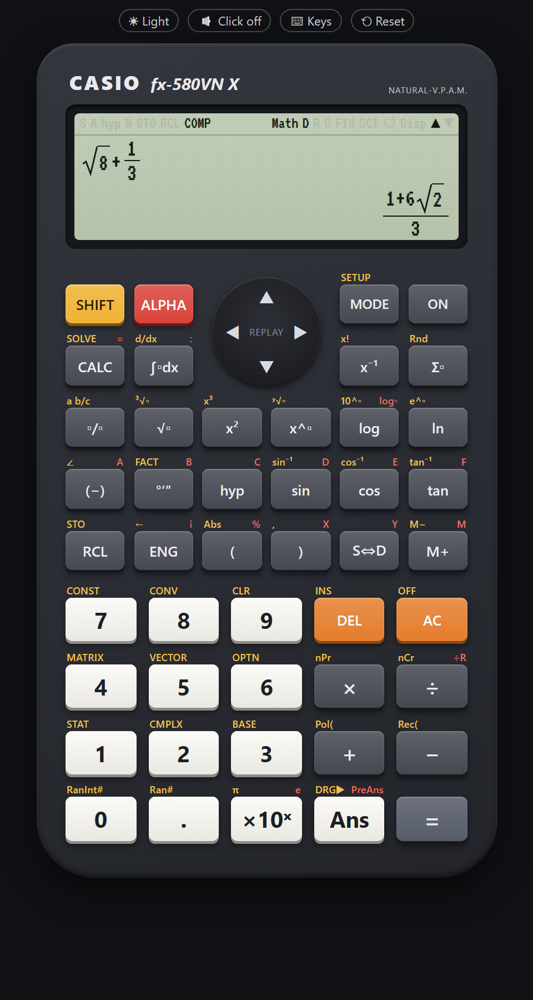

# fx-580VN X Emulator

An offline emulator of the **Casio fx-580VN X** scientific calculator: Natural-V.P.A.M. display with real 2D layout
(stacked fractions, radicals, superscripts), exact arithmetic (fractions, radicals, π), the full key set with SHIFT /
ALPHA legends, and 13 calculation modes. It runs in the browser and as a desktop app (Tauri/Rust). There is no backend
and no network access.



> **Honesty note.** This project was built without a physical calculator at hand. Wherever the real device's
> behaviour was uncertain the choice made is listed in [`docs/ASSUMPTIONS.md`](docs/ASSUMPTIONS.md) and pinned by a
> test marked `// UNVERIFIED` in `engine/tests/unverified.test.ts`. The keypad layout and legends approximate the
> fx-580VN X (they follow the fx-991ES/EX family from memory) rather than copying it pixel for pixel.

## Quick start

```bash
npm install
npm run dev            # browser, http://localhost:5173
npm test               # 1000+ engine tests (Vitest, includes fast-check property tests)
npm run lint           # ESLint (typescript-eslint)
npm run build          # type-checks engine + UI, builds ui/dist

npm run tauri:dev      # desktop app against the running dev server (run `npm run dev` first)
npm run package        # NSIS installer into src-tauri/target/release/bundle/nsis
npm run package:dir    # unpacked binary only (fast; used to verify packaging)
```

Requirements: Node 20+ (developed on Node 24), Rust (stable, `rustup`), and on Windows the MSVC Build Tools
("Desktop development with C++" workload) for the `link.exe` the Rust `x86_64-pc-windows-msvc` target needs.
WebView2 (preinstalled on Windows 11) renders the UI; no Chromium is bundled.

Developer tools (need `npx playwright install chromium` once):

```bash
node scripts/lcds.mjs out/m "mode|1 add 2 eq"   # screenshot of the LCD after key sequences (key ids, '|' separates runs)
node scripts/shot.mjs out.png "frac 1 down 3 right eq"   # full page screenshot + console error check
node scripts/e2e.mjs                             # browser end-to-end: input, persistence, all modes, phone viewport, console errors (npm run e2e)
node scripts/tauri-smoke.mjs                     # launches the packaged app, checks it stays alive (npm run smoke:tauri)
```

## Layout of the repository

```
engine/            pure TypeScript, zero UI dependencies (Vitest + fast-check)
  src/bigmath.ts rational.ts exact.ts   BigInt rationals; ring of Σ c·π^p·√r terms (canonical form)
  src/num.ts mathfn.ts complex.ts       exact/15-digit number type, functions, overflow rules
  src/matrix.ts stat.ts dist.ts poly.ts matrices/vectors, statistics, distributions, polynomial solver
  src/items.ts parser.ts ast.ts         editor items -> tokens -> AST (fx priority sequence)
  src/evaluator.ts fast.ts solver.ts    evaluation, ∫ d/dx (Gauss–Kronrod, Ridders), SOLVE
  src/format/                           number formats (Norm/Fix/Sci/ENG) and natural display trees
  src/editor/                           structured 2D editor (cursor paths, insert/delete inside templates)
  src/pad.ts calculator.ts keypad.ts    calculation pad (history, CALC, SOLVE), key state machine, key table
  src/modes/                            comp (COMP+CMPLX) basen eqn ineq stat dist table matrix verify ratio spread
  tests/                                golden tests, key-sequence tests, property tests, fuzz tests
ui/                React + Vite: LCD renderer, keypad, keyboard mapping, persistence, sound
src-tauri/         desktop wrapper (Rust, `tauri.conf.json`, `src/main.rs` + `src/lib.rs`)
docs/ASSUMPTIONS.md                     every uncertain device behaviour
scripts/                                screenshot / smoke-test helpers
legacy/            the single-file prototype that was in the folder before this project
```

## Using the calculator

Click the keys, or use the physical keyboard (table below). State (variables, Ans, history, settings, STAT /
matrix / table data) is saved in the browser's local storage / the WebView2 profile after every key press.
`SHIFT`+`AC` switches the calculator off (blank LCD, memory kept), `ON` wakes it up again. The toolbar toggles
light/dark theme and the key click sound, and `Reset` forgets the saved state.

### Natural display editing

* `▫/▫` takes the digits left of the cursor as numerator and moves the cursor to the denominator; `SHIFT`+`▫/▫` is the
  mixed fraction. `√`, `³√`, `ʸ√`, `x^▫`, `10^▫`, `e^▫`, `log▫`, `Abs`, `Σ`, `∫`, `d/dx`, `×10ˣ` are templates; `▶`
  leaves the current slot. `x²`, `x³`, `x⁻¹` are atomic.
* `◀ ▶` walk through the whole structure; `▲ ▼` switch between numerator/denominator (and limits) or — outside a
  template — browse the history (REPLAY). After a result `◀` edits the expression (cursor at the end), `▶` puts the cursor
  at the start.
* `DEL` removes the item left of the cursor (an empty template in one go; on the right edge of a filled template it
  first moves inside). `SHIFT`+`DEL` toggles insert/overwrite. Long expressions scroll horizontally; `◀ ▶` marks on the
  LCD show clipped content. Missing closing brackets at the end are added automatically.
* After `=` an operator key continues with `Ans` (`Ans+…`), a digit starts a new calculation.
* `S⇔D` switches between the exact form (fraction, radical, π) and the decimal form, when both exist. A number typed
  with a decimal point gives a decimal first result, and `S⇔D` then shows the exact value (`0.5` ⇄ `1/2`).
* `ENG` / `SHIFT`+`ENG` shift the exponent by ±3; `SHIFT`+`Ans` (DRG▶) offers `°`, `ʳ`, `ᵍ` and `▶DMS`.
* Errors: `Math ERROR`, `Syntax ERROR`, `Stack ERROR`, `Argument ERROR`, `Dimension ERROR`, `Can't Solve`,
  `Time Out`. `AC` cancels, `◀`/`▶` jumps to the failing position.

### CALC and SOLVE

Type an expression with variables (`ALPHA` letters), press `CALC`: each variable is asked in order of appearance (`=`
keeps the current value). `SHIFT`+`CALC` (SOLVE) solves `L = R` (type `=` with `ALPHA`+`CALC`) or `f(X) = 0`: enter the
other variables, then the initial value; the result shows `X=…` and `L−R=…`. `Can't Solve` is reported when no root is found.

### Modes (`MODE` menu; `▼` shows entries 11–13)

| # | Mode | What it does |
|---|------|--------------|
| 1 | Calculate | everything in the keypad, exact results, `:` multi-statements |
| 2 | Complex | `i` (ENG key), `a+bi` / `r∠θ` (SETUP > Complex), `SHIFT 2`: Arg, Conjg, ReP, ImP, ▶r∠θ, ▶a+bi |
| 3 | Base-N | Bin/Oct/Dec/Hex (`x²`/`x^▫`/`log`/`ln` choose the base), `SHIFT 3`: d h b o Neg Not and or xor xnor, 32-bit signed |
| 4 | Equation | simultaneous equations (2–4 unknowns), polynomials of degree 2–4 with exact roots |
| 5 | Inequality | polynomial inequalities of degree 2–4 with exact interval endpoints |
| 6 | Statistics | 1-VAR and 7 regression types, data editor (X, Y, FREQ), `SHIFT 1` menu: Sum, Var, MinMax, Reg, Distr |
| 7 | Distribution | normal / binomial / Poisson: PD, CD and inverse |
| 8 | Table | f(X) (and g(X) with SETUP > Table), Start / End / Step |
| 9 | Matrix | MatA–MatD up to 4×4: + − × scalar, det, Trn, inverse (`x⁻¹`), Ident, Abs, MatAns |
| 10 | Vector | VctA–VctD (2/3 components): + −, `·` dot, `×` cross, Abs, Angle, UnitV |
| 11 | Ratio | `a:b = X:d`, `a:b = c:X` |
| 12 | Spreadsheet | 5×45 cells, formulas (`=A1+B2`, `SUM(A1:A5)`, …) |
| 13 | Verify | TRUE/FALSE for equations and inequalities (`SHIFT 6` relation menu) |

`SETUP` (`SHIFT`+`MODE`): input/output (MthIO/LineIO), angle unit, number format (Fix/Sci/Norm), engineer symbols,
fraction result (ab/c or d/c), complex format, statistic frequency, table f/g, decimal mark, digit separator.
`SHIFT 7` CONST (40 constants, type the 2-digit code), `SHIFT 8` CONV (40 unit pairs), `SHIFT 9` CLR (setup / memory / all),
`SHIFT 6` OPTN (GCD, LCM, Int, Intg, Rem, Quotient, RanInt#, Ran#, Rnd, Fact).

### Keypad

Key ids are what `calculator.press(id)` and the test helpers use.

| Block | Key id | Key | SHIFT | ALPHA |
|---|---|---|---|---|
| top 1 | `shift` | SHIFT |  |  |
| top 1 | `alpha` | ALPHA |  |  |
| top 1 | `mode` | MODE | SETUP |  |
| top 1 | `on` | ON |  |  |
| pad | `left` `up` `down` `right` | REPLAY ◀ ▲ ▼ ▶ |  |  |
| top 2 | `calc` | CALC | SOLVE | = |
| top 2 | `integ` | ∫▫dx | d/dx | : |
| top 2 | `inv` | x⁻¹ | x! |  |
| top 2 | `sigma` | Σ▫ | Rnd |  |
| top 3 | `frac` | ▫/▫ | a b/c |  |
| top 3 | `sqrt` | √▫ | ³√▫ |  |
| top 3 | `sq` | x² | x³ |  |
| top 3 | `pow` | x^▫ | ʸ√▫ |  |
| top 3 | `log` | log | 10^▫ | log▫ |
| top 3 | `ln` | ln | e^▫ |  |
| top 4 | `neg` | (−) | ∠ | A |
| top 4 | `dms` | °′″ | FACT | B |
| top 4 | `hyp` | hyp |  | C |
| top 4 | `sin` | sin | sin⁻¹ | D |
| top 4 | `cos` | cos | cos⁻¹ | E |
| top 4 | `tan` | tan | tan⁻¹ | F |
| top 5 | `rcl` | RCL | STO |  |
| top 5 | `eng` | ENG | ENG← | i |
| top 5 | `lpar` | ( | Abs | % |
| top 5 | `rpar` | ) | , | X |
| top 5 | `sd` | S⇔D |  | Y |
| top 5 | `mplus` | M+ | M− | M |
| bottom 1 | `7` `8` `9` | 7 8 9 | CONST CONV CLR |  |
| bottom 1 | `del` `ac` | DEL AC | INS OFF |  |
| bottom 2 | `4` `5` `6` | 4 5 6 | MATRIX VECTOR OPTN |  |
| bottom 2 | `mul` `div` | × ÷ | nPr nCr | – ÷R |
| bottom 3 | `1` `2` `3` | 1 2 3 | STAT CMPLX BASE |  |
| bottom 3 | `add` `sub` | + − | Pol( Rec( |  |
| bottom 4 | `0` `dot` | 0 . | RanInt# Ran# |  |
| bottom 4 | `exp` | ×10ˣ | π | e |
| bottom 4 | `ans` | Ans | DRG▶ | PreAns |
| bottom 4 | `eq` | = |  |  |

`STO`: press `SHIFT`+`RCL`, then the variable key (`(−)`=A, `°′″`=B, `hyp`=C, `sin`=D, `cos`=E, `tan`=F, `)`=X, `S⇔D`=Y, `M+`=M).
`RCL` + variable key inserts the variable. `hyp` followed by `sin`/`cos`/`tan` (or `SHIFT`+) gives the hyperbolic functions.

### Physical keyboard

| Keyboard | Calculator | Keyboard | Calculator |
|---|---|---|---|
| `0-9` `.` | digits | `s` `c` `t` | sin cos tan (`S` `C` `T`: inverse) |
| `+ - * /` | + − × ÷ | `l` `g` | ln log |
| `Enter` `=` | = | `r` / `R` | √ / ³√ |
| `Backspace` | DEL | `q` / `Q` | x² / x³ |
| `Esc` | AC | `f` / `F` | fraction / mixed fraction |
| arrows | REPLAY pad | `p` | π |
| `(` `)` `,` | ( ) , | `e` / `E` | e / ×10ˣ |
| `^` | x^▫ | `x` `y` `m` | X Y M+ |
| `!` `%` | x! % | `A` `B` `D` | variables A B D |
| `Tab` | S⇔D | `n` `d` | (−) °′″ |
| `F1` `F2` | SHIFT ALPHA | `v` `V` | CALC SOLVE |
| `F3` `F4` | MODE SETUP | `w` `W` `u` | ∫ d/dx Σ |
| `F5` `F6` | ON OFF | `i` `k` `o` | x⁻¹ hyp RCL |

(The in-app **⌨ Keys** button shows the same table.)

## Accuracy

* Exact values are sums of `c·π^p·√r` with rational `c` (BigInt numerator/denominator) and square-free `r`; the
  representation is canonical, so equality tests are exact. Division rationalises denominators (`1/(√3−1) = (1+√3)/2`).
* Everything else is an approximation held with 60 internal digits and rounded to **15 significant digits**; the LCD
  shows **10**. Results ≥ 10^100 are `Math ERROR`, below 10^-99 underflow to 0.
* Trigonometry is exact for multiples of 15° (π/12), inverse trigonometry returns exact angles for the same special
  values (`asin(1/2)` = `30` or `π/6`), logarithms are exact when the argument is a rational power of the base.
* `∫` uses adaptive Gauss–Kronrod (G7K15), `d/dx` Ridders extrapolation, both in double precision with a fast
  closure compiler (~1–3 ms for typical integrands); `Σ` is exact.

### Tests

`npm test` runs ~1100 tests: golden COMP cases (exact forms, rounding, precedence, implicit multiplication, errors),
every mode (complex, base-N, equations, inequalities, statistics, distributions, table, matrix, vector, ratio,
verify, spreadsheet), key-sequence tests that drive the real state machine, a fast-check comparison of the decimal
engine against `decimal.js` at 120 digits, performance guards, and a fuzz test that presses random keys in every
mode and asserts that the engine never fails unexpectedly. To pin down a device behaviour add a case to
`engine/tests/comp.test.ts` (or `unverified.test.ts` with `// UNVERIFIED` and an entry in `docs/ASSUMPTIONS.md`).

## Not yet implemented / known limitations

* Not the same pixels as the real device: key shapes, legends and menu numbering are approximations (see assumptions K1).
* Spreadsheet: no Cut/Copy/Paste/Fill commands and no CELL menu (typing `A`+digits builds references).
* Statistics: no graphs; `x̂`/`ŷ` are typed as functions `x̂(`, `ŷ(` instead of as postfix keys; row limits are 80/40.
* Equation mode: only *Simultaneous* and *Polynomial*; no function-analysis ("Func") screens. Cubic/quartic roots that
  are not rational/biquadratic are numeric.
* SOLVE solves for `X` (or the first variable) only; there is no variable chooser on the initial-value screen.
* Table: the x column cannot be edited directly; only the Start/End/Step prompts define it.
* Matrix results are shown as a cell grid (no scaled 2D matrix); at most four matrices/vectors.
* Fraction results of more than 10 digits per part, more than 4 terms in a sum, or π powers beyond ±2 are shown as decimals.
* Installers were only built and checked on Windows (`src-tauri/target/release`); macOS/Linux targets are configured but untested.
* The device's exact algorithms for `∫`, `d/dx` and SOLVE are unknown; results agree to about 10 significant digits for smooth cases.

## Maintenance and deployment

See [`agent.md`](agent.md) for the contributor/agent guide (architecture, conventions, how to add features, pitfalls).

### Where the installed app lives

The desktop app is installed outside the repository, in `D:\C\program\fx580vnx\` (executable
`fx-580VN X Emulator.exe`). When packaged it keeps its saved state (variables, history, settings, STAT/matrix data) in
`D:\C\program\fx580vnx\data\`. The Desktop shortcut `fx-580VN X.lnk` points at that executable.

### Redeploy after a change (Windows, PowerShell, from the repository root)

```powershell
npm test; npm run lint                      # must be green
npm run package:dir                         # build ui + cargo build --release -> src-tauri\target\release\fx580vnx.exe
# close the running app first, then replace the executable (the "data" folder next to it is untouched):
Copy-Item src-tauri\target\release\fx580vnx.exe "D:\C\program\fx580vnx\fx-580VN X Emulator.exe" -Force
```

(The frontend is embedded in the binary at compile time, so this is a single-file copy — no directory sync needed.
If the shortcut is lost, recreate it with `WScript.Shell` `CreateShortcut`: target
`D:\C\program\fx580vnx\fx-580VN X Emulator.exe`, icon `...\icon.ico`.)

### Routine checks

| Command | Purpose |
|---|---|
| `npm test` | all engine tests (~1080) |
| `npm run lint` / `npm run build` | style and type-check (engine + ui) / production bundle |
| `npm run e2e` | browser end-to-end check (needs a prior `npm run build`) |
| `npm run smoke:tauri` | launches the packaged binary and checks it stays alive |
| `node scripts/lcds.mjs <prefix> "<keys>\|<keys>"` | LCD screenshots after key sequences |

### Updating dependencies

Run `npm update`, then the checks above. For the Rust side run `cargo update` inside `src-tauri/`. Pinned majors worth
watching: `decimal.js` (all numerics), `vite`, `tauri` (2.x).
